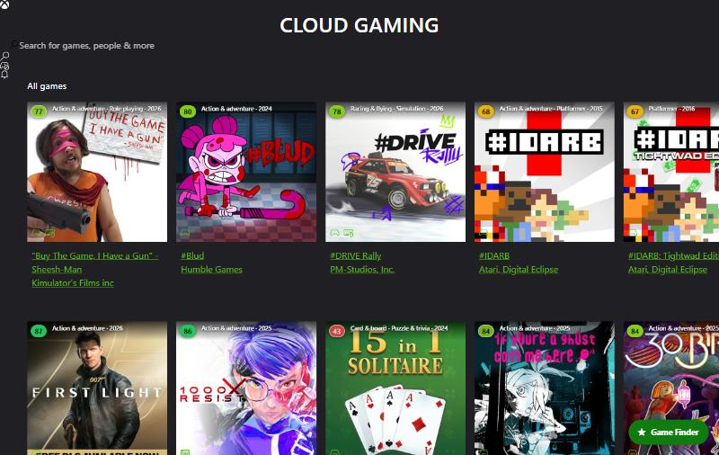
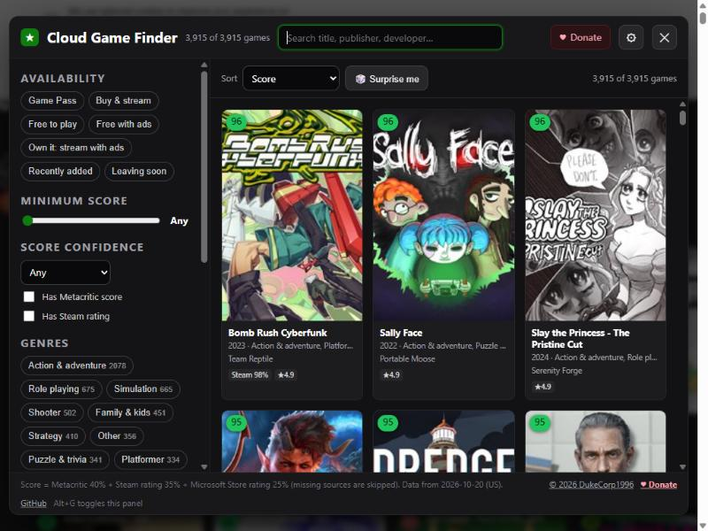

# Useful Xbox Cloud Online JS

**Find the good games on Xbox Cloud Gaming, fast.** A [DukeCorp1996](https://dukecorp1996.x35.in/) project.

A Tampermonkey userscript for [xbox.com/play](https://www.xbox.com/play) that puts a rating score and genre on every game tile and adds a **Game Finder** panel. Use it to filter the whole cloud catalog (about 3,900 games) by score, genre, Game Pass, free-to-play, touch support, co-op and more.

> ❤️ **Free for personal use. If it helps you, please donate:** **[dukecorp1996.x35.in](https://dukecorp1996.x35.in/)**. Donations keep the scores fresh and the script maintained.

| Score badges + genres on tiles | Game Finder |
| --- | --- |
|  |  |

---

## Goals

Xbox Cloud Gaming has thousands of streamable games, but the site gives you almost nothing to judge them by: no rating scores, no sorting by quality, and only a handful of fixed galleries. This project aims to:

1. **Show a quality score on every game**, everywhere on the site (home, galleries, search, game pages).
2. **Show the genre at a glance**, so you don't have to open each game to know what it is.
3. **Make the whole catalog filterable and sortable** in one place: score, genre, Game Pass / free / buy & stream, touch or mouse & keyboard, co-op and multiplayer, release year.
4. **Work instantly and privately.** All scores are bundled into the script, with no account, no tracking and no third-party server.
5. **Stay up to date** through a repeatable data pipeline that anyone can re-run.

## Features

- **Score badges on game tiles**, color-coded from red to green. Hover a badge for the breakdown (Metacritic, Steam %, Microsoft Store stars, vote counts) and genres.
- **Genre + release year** label on each tile.
- **Score card on game pages**, with links to the game's Steam page and a Metacritic search.
- **Game Finder panel** (button at the bottom-right, or <kbd>Alt</kbd>+<kbd>G</kbd>):
  - search by title, publisher or developer
  - availability: Game Pass, Buy & stream, Free to play, Free with ads (no subscription), Own it & stream with ads
  - recently added and leaving soon
  - minimum score, score confidence, "has Metacritic", "has Steam rating"
  - genres: click once to include, again to exclude, a third time to clear
  - touch controls, mouse & keyboard
  - single player, online/local co-op, online/local multiplayer, cross-play
  - release year range
  - sort by score, Metacritic, Steam rating, store rating, most rated, Xbox popularity, newest, oldest, A–Z
  - 🎲 **Surprise me** opens a random game from your current results
- **Dim low scorers** (optional): fade games below a chosen score on the normal Xbox pages so the good ones stand out.
- **New games** that aren't in the bundled data yet get their Microsoft Store rating looked up live and cached for 7 days. This can be turned off.
- Hides itself while you're streaming a game, so it never gets in the way of play.
- Your filters and settings are remembered.

## Install

1. Install [Tampermonkey](https://www.tampermonkey.net/) for your browser (Chrome, Edge, Firefox, Safari, Opera).
2. Open **[dist/xbox-cloud-scores.user.js](https://raw.githubusercontent.com/Balls0fSteel/Useful-Xbox-Cloud-Online-JS/main/dist/xbox-cloud-scores.user.js)**. Tampermonkey shows an install page; click **Install**.
3. Go to [xbox.com/play](https://www.xbox.com/play). Tiles get score badges, and the **Game Finder** button appears at the bottom-right.

Tampermonkey checks for updates automatically. Each data refresh bumps the version number, so you get new scores without doing anything.

> Chrome / Edge note: recent versions require **Developer mode** (or "Allow user scripts") to be enabled for Tampermonkey on the extensions page before userscripts run.

## How the score works

Each game gets one **0–100 score**, a weighted average of whichever sources exist for it:

| Source | Weight | Notes |
| --- | --- | --- |
| Metacritic (critics) | 40% | Taken from the game's Steam listing when it shows a Metacritic score |
| Steam rating (% positive) | 35% | Uses the [SteamDB rating formula](https://steamdb.info/blog/steamdb-rating/), which pulls games with few ratings toward 50% |
| Microsoft Store user rating | 25% | 1–5 stars mapped onto 0–100 using a Bayesian average, so a handful of 5-star votes can't top the chart |

Missing sources are skipped and the remaining weights are rescaled. Only aggregate numbers are used (a Metacritic score, Steam's % positive and count, store stars and count). No individual review texts are fetched or shown. Every game also gets a **confidence** level:

- **Critic + users:** a Metacritic score plus at least 200 user ratings.
- **Decent sample:** a Metacritic score or 300+ user ratings.
- **Some ratings:** a few user ratings only. These badges get a white ring, meaning "take with a grain of salt".

Badge colors: **85+** green, **75–84** lime, **65–74** yellow, **50–64** orange, **below 50** red, **–** no data.

Steam matching is done by normalized title (edition names, ™/®, "Xbox Series X|S" and similar are stripped). Games that aren't on Steam keep only their Microsoft Store rating. If a match is wrong, it can be fixed in [`data/overrides.json`](#fixing-a-wrong-match).

## Data pipeline

The scores are bundled into the userscript at build time. Everything is plain Node.js (18+) with no dependencies.

```bash
npm run data        # fetch catalog + ratings + Steam data -> data/games.json
npm run build       # bundle src/ + data/games.json -> dist/xbox-cloud-scores.user.js
npm run all         # both
npm run data:quick  # refresh catalog + store ratings only, reuse cached Steam data
```

Sources, all public endpoints that need no API key:

| What | Where |
| --- | --- |
| Cloud catalog lists (All games, Game Pass, Buy & stream, free with ads, recently added, leaving soon, popularity order) | `catalog.gamepass.com/sigls/v3`, the same lists xbox.com/play uses |
| Titles, genres, publisher, release date, input types, multiplayer modes, images | `catalog.gamepass.com/v3/products` |
| Microsoft Store star ratings and vote counts | `displaycatalog.mp.microsoft.com/v7.0/products` |
| Steam app match + Metacritic score | `store.steampowered.com/api/storesearch` |
| Steam rating summaries: % positive and count, batched (no review texts) | `api.steampowered.com/IStoreBrowseService/GetItems` |

Steam lookups are cached in `data/cache/steam.json`, so later runs only look up new or stale games. The first full run takes about 25 minutes, mostly polite rate-limiting toward Steam. Use `--market GB --language en-GB` (for example) to build for another region.

### Fixing a wrong match

`data/overrides.json` maps an Xbox product ID (the 12-character code at the end of a game URL) to a fixed Steam app ID and/or Metacritic score:

```json
{
  "9P8NKVVB0XQJ": { "steam": 1145360 },
  "9NBLGGH4R315": { "steam": null },
  "9N4PT8HGCDHQ": { "metacritic": 84 }
}
```

`"steam": null` means "this game is not on Steam, don't match it". Re-run `npm run all` afterwards.

### Testing locally

`node test/serve.mjs <snapshotDir> [port]` serves HTML saved from xbox.com/play (the `#root` element's outerHTML) with the site's CSS and the built script injected. That way the badges and the Finder can be checked without installing anything. Snapshots can contain your gamertag and avatar, so they're git-ignored.

## Privacy

- No analytics, no tracking, no external server of ours.
- Settings and filters are stored in Tampermonkey's own storage.
- The only network requests the script makes are optional live lookups for games newer than the bundled data, sent to Microsoft's public catalog endpoints (`catalog.gamepass.com`, `displaycatalog.mp.microsoft.com`).

## Roadmap

See [PLAN.md](PLAN.md). Highlights: automatic weekly data refresh via GitHub Actions, more critic sources (OpenCritic / IGDB), a "hide games I've played" list, and an optional browser extension build from the same bundle.

## Donate

This project is made and maintained by DukeCorp1996 in spare time. Every data refresh means a fresh pass over the catalog, Steam matching and calibration. If the script saved you from scrolling through 3,900 tiles, please consider a donation:

### 👉 [dukecorp1996.x35.in](https://dukecorp1996.x35.in/)

The Game Finder has a **♥ Support** button and a footer **Donate** link that go to the same page. Bug reports and ideas are welcome in [Issues](https://github.com/Balls0fSteel/Useful-Xbox-Cloud-Online-JS/issues).

## License

Copyright 2026 DukeCorp1996 (<https://dukecorp1996.x35.in/>).

Useful Xbox Cloud Online JS is free for **noncommercial** use under the [PolyForm Noncommercial License 1.0.0](LICENSE.md): personal use, study, hobby projects, and use by charities, schools, research and public institutions. You may share and modify it on the same terms, as long as the `Required Notice` line from [LICENSE.md](LICENSE.md) stays with every copy (it is also in the userscript header). Commercial use needs separate permission from DukeCorp1996. This makes the project source-available rather than open source in the OSI sense.

## Disclaimer

Not affiliated with, endorsed by, or sponsored by Microsoft, Xbox, Valve/Steam or Metacritic. Xbox, Xbox Cloud Gaming, Game Pass, Steam and Metacritic are trademarks of their owners and are used only to identify those products and services. Scores are computed from public user and critic ratings and are only a guide; your taste may differ.
